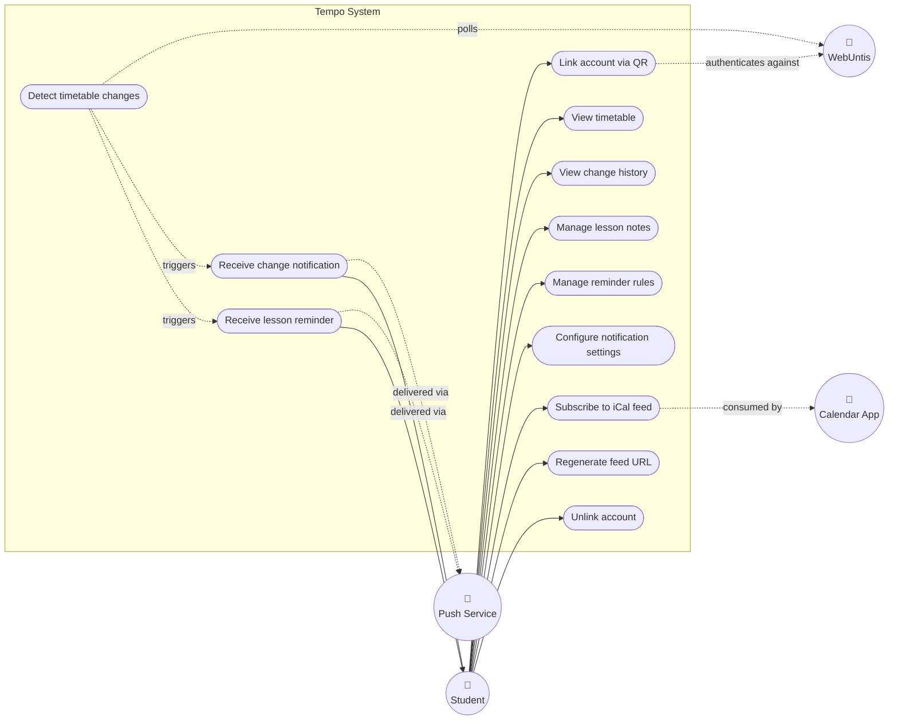
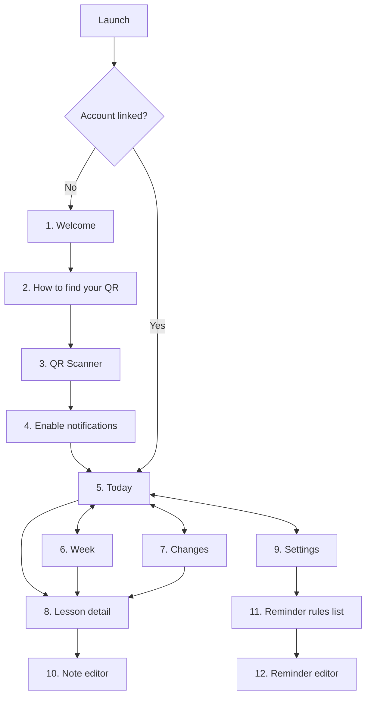
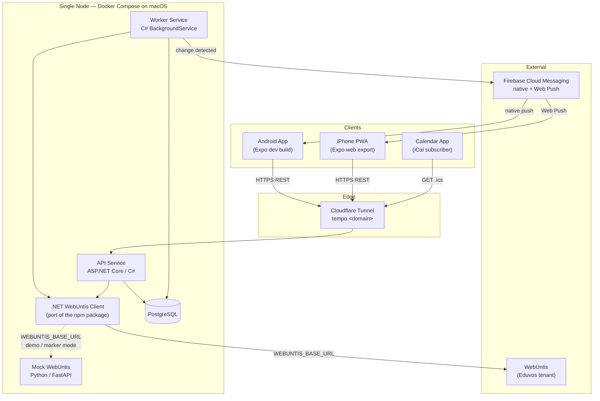
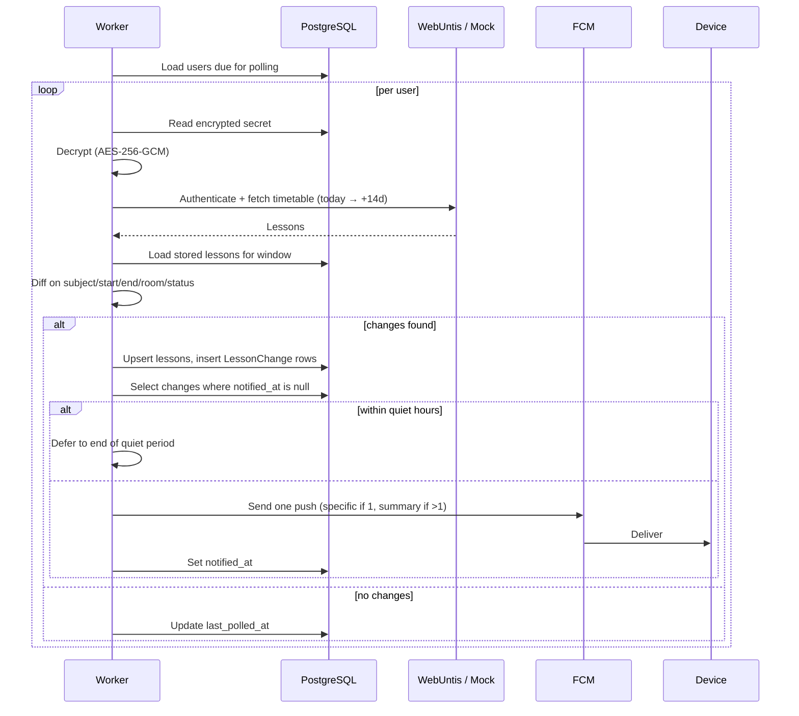
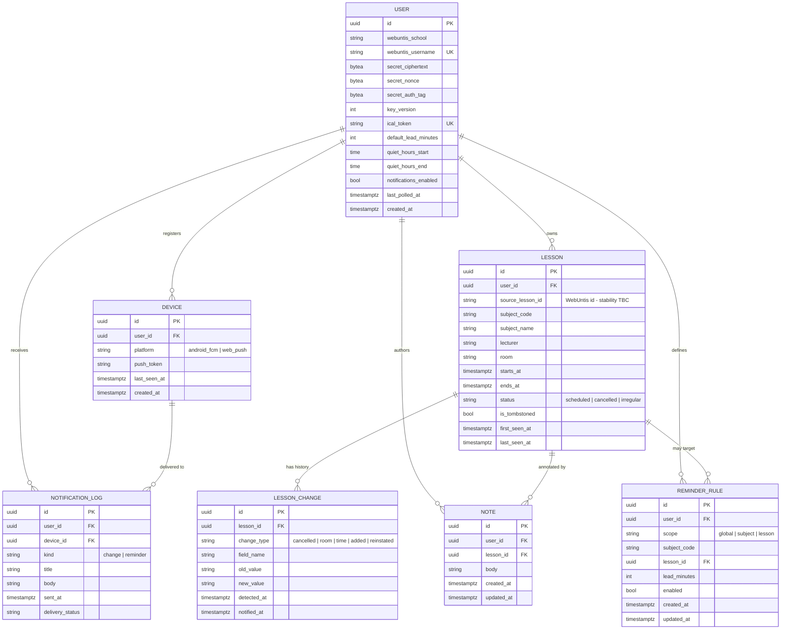

# Tempo — Project Brief

**Module:** ITMDA3-B34 · **Team size:** 6 · **Status:** Planning (Deliverable 1)
**Last updated:** 2026-08-29

---

## 0. How to use this document

This is the **single source of truth** for the Tempo project. Every one of the seven
Deliverable 1 documents is expanded out of a section of this brief:

| Deliverable | Source section | Owner |
| --- | --- | --- |
| Topic selection & use case description | §1, §2, §3 | TBD |
| PRD | §1–§8 | TBD |
| Functional & non-functional requirements | §6, §7 | TBD |
| User stories & use case diagram | §8, §9 | TBD |
| Wireframes / mockups | §10 | TBD |
| Architecture design | §12 | TBD |
| Data design (ERD) | §13 | Nicholas |

**Rules for working from this doc:**

1. Requirement IDs (`FR-1`, `NFR-1`) are stable. Reference them; never renumber them.
2. If your document needs to contradict this brief, change the brief first and tell the team.
3. Items marked `TODO-MEASURE` need real data before submission — they are not decorative.

---

## 1. Topic selection

**Domain:** Higher-education timetable management for Eduvos students.

**Product:** *Tempo* — a mobile-first timetable companion that mirrors the institution's
WebUntis schedule, detects changes to it, and pushes those changes to the student's phone.

---

## 2. Problem statement

Eduvos publishes student timetables through **WebUntis**. The system holds correct data, but
the way students are made to consume it fails them in four distinct ways:

1. **The web interface is not mobile-optimised.** Students overwhelmingly check their
   timetable on a phone. The WebUntis web client is a desktop layout served to a phone screen:
   dense grids, small tap targets, horizontal scrolling.
2. **It is slow.** Every timetable check is a full round trip — load, authenticate, navigate,
   render. There is no local cache, so a student on poor campus connectivity gets a blank
   screen or a spinner. `TODO-MEASURE: cold-load time to visible timetable on 4G.`
3. **There is no onboarding.** The native Untis app is a hassle to set up, and neither client
   explains how to find your credentials, what a "school" is, or where the QR code lives.
   `TODO-MEASURE: number of taps/screens from app launch to seeing today's timetable.`
4. **Timetables change, and nothing tells you.** Both clients are strictly **pull-based**.
   A cancelled lecture, a room change, or a moved period is invisible until the student
   happens to open the app and look. In practice, students travel to campus for classes that
   were cancelled, or sit in the wrong venue.

Compounding all four, Eduvos has **not enabled iCal export**, so students cannot subscribe to
their timetable from the calendar app they already use — the one place a change would have
been visible without extra effort.

### 2.1 Why this is not solved by an email to IT

A reviewer will reasonably ask why the team did not simply ask Eduvos to enable the missing
features. The answer distinguishes the two halves of the problem:

- **iCal export** is a configuration toggle Eduvos controls. Asking is worth doing, and a
  written refusal is itself evidence for this project. `TODO: send the request, keep the reply.`
- **Mobile performance, onboarding quality, and change notification are Untis product
  defects.** No Eduvos administrator can make the WebUntis client fast, teach it to onboard a
  new student, or make it push a cancellation to a locked phone. Those require a different
  client — which is what Tempo is.

### 2.2 Evidence to collect

| Evidence | Method | Status |
| --- | --- | --- |
| Cold-load time, WebUntis mobile web on 4G | Stopwatch, 5 trials, median | `TODO-MEASURE` |
| Taps from launch → today's timetable | Count on both WebUntis web and Untis app | `TODO-MEASURE` |
| Screenshots of the current mobile experience | Phone screenshots, annotated | `TODO-MEASURE` |
| Student experience of missed/changed classes | Short form to the cohort (~30–50 responses) | `TODO` |
| Eduvos response re: iCal export | Email to IT | `TODO` |

These numbers turn §7's non-functional requirements from asserted into evidenced, and they
supply the "before" half of the showcase.

---

## 3. Solution overview

Tempo is a **read-mostly mirror of the student's WebUntis timetable, plus a change-detection
service, plus two student-owned data modules.**

- The student scans the QR code from their WebUntis profile **once**. No username, no
  password, no signup form.
- A backend service polls WebUntis on the student's behalf, compares each poll against the
  last known state, and records every difference as a change event.
- Changes are pushed to the student's phone — **native push on Android, Web Push on iPhone.**
- The app opens instantly from a local cache, online or off.
- The student's timetable is available as a **subscribable iCal feed**, restoring the feature
  Eduvos disabled.
- The student can attach **notes** to lessons and define **custom reminder rules** — the two
  read-write modules that make Tempo theirs rather than just a viewer.

### 3.1 One-line pitch

> *WebUntis tells you what your timetable is. Tempo tells you when it changes.*

---

## 4. Users & personas

Tempo has **one** user role. There is no lecturer, admin, or institutional role — a deliberate
scope decision (§5).

**Persona A — Thabo, 2nd-year student, Android.**
Checks his timetable on the bus every morning. Has been caught out twice by cancellations
announced only in a lecture he didn't attend. Wants a glanceable "where am I supposed to be
right now" and to be told when that answer changes. Data-conscious; poor signal on campus.

**Persona B — Aisha, 3rd-year student, iPhone.**
Lives in her calendar app; everything else — work shifts, gym, study group — is already there.
Frustrated that the one schedule she cannot subscribe to is the one that matters most. Wants
her lectures inside the calendar she already uses, and a nudge before each class.

**Persona C — The marker (secondary "user").**
Must be able to clone the repository, run one command, and see the entire system work
end-to-end **without Eduvos credentials or network access to the team's WebUntis instance.**
This persona drives the mock service in §12.4 and is a first-class design constraint, not an
afterthought.

---

## 5. Scope

### 5.1 In scope

- QR-based account linking to WebUntis
- Today / Week / Changes / Lesson detail / Settings screens
- Offline-first cached timetable
- Server-side polling and change detection
- Push notifications (Android native + iOS Web Push)
- Pre-lesson reminders with configurable lead time and quiet hours
- **Lesson Notes** (full CRUD)
- **Custom Reminder Rules** (full CRUD)
- Subscribable iCal feed with regenerable token
- Mock WebUntis service for offline/marker demonstration

### 5.2 Explicitly out of scope

Recording what we chose *not* to build is deliberate — each of these was considered and cut.

| Out of scope | Why |
| --- | --- |
| Personal (non-lecture) events | Product is a *timetable mirror*; personal calendar merging is Phase 2 |
| Lecturer or admin-facing features | Single-role product; no institutional integration |
| Homework, grades, attendance | Not exposed by the data source we have access to |
| Social features, chat, sharing | No connection to the problem statement |
| Email/password accounts | Contradicts the zero-friction onboarding thesis (see §11.1) |
| Manual credential entry | Institution exposes access via QR only |
| Redis cache | Six concurrent users; the cache solves a problem we do not have |
| Multi-institution support | Single WebUntis tenant is sufficient to prove the concept |
| Production hosting / uptime SLA | Showcase project on a single self-hosted node |

### 5.3 Phase 2 (documented, not built)

Personal events, subject aliasing and colour customisation, multi-institution support,
widget / lock-screen surface, timetable sharing between students.

---

## 6. Functional requirements

### 6.1 Onboarding & identity

| ID | Requirement |
| --- | --- |
| FR-1 | The app shall present an onboarding sequence explaining what Tempo does and how to locate the WebUntis QR code before requesting camera access. |
| FR-2 | The app shall scan a WebUntis QR code using the device camera and extract the school, username, and shared secret. |
| FR-3 | The system shall create a user identity from the scanned credentials, or match an existing identity if the same WebUntis username has been linked before. |
| FR-4 | The system shall register the scanning device against the user identity, recording its platform and push subscription. |
| FR-5 | The app shall support the same user identity across multiple devices by re-scanning the QR code on each device. |
| FR-6 | The app shall request notification permission only after displaying an in-app explanation of what notifications will be used for. |
| FR-7 | The app shall allow the user to unlink their account, which shall delete the stored credentials and all server-side data for that user, and clear the local cache. |
| FR-8 | The app shall offer an optional biometric / PIN lock that must be satisfied before timetable data is displayed. |

### 6.2 Timetable display

| ID | Requirement |
| --- | --- |
| FR-9 | The app shall display a **Today** view showing the current and next lesson prominently, plus the remainder of the day. |
| FR-10 | The app shall display a **Week** view showing all lessons for the selected week. |
| FR-11 | The app shall allow the user to navigate to adjacent weeks. |
| FR-12 | The app shall display a **Lesson detail** view showing subject, lecturer, room, start and end time, current status, and the change history for that lesson. |
| FR-13 | The app shall render timetable data from a local cache without requiring a network request. |
| FR-14 | The app shall display the time of the last successful synchronisation on the Today view. |
| FR-15 | The app shall support manual refresh (pull-to-refresh) with a visible loading indicator. |
| FR-16 | The app shall visually distinguish cancelled, moved, and newly added lessons from unchanged lessons using both colour and a non-colour indicator (icon or label). |

### 6.3 Change detection & notification

| ID | Requirement |
| --- | --- |
| FR-17 | The backend shall poll WebUntis for each linked user on a configurable interval. |
| FR-18 | The backend shall compare each poll result against the stored state across a defined field set: subject, start time, end time, room, and status. |
| FR-19 | The backend shall restrict change detection to lessons falling within a configurable window (default: today through +14 days). |
| FR-20 | The backend shall persist every detected change as an immutable change record capturing type, previous value, new value, and detection time. |
| FR-21 | The backend shall send at most **one** push notification per user per poll cycle. |
| FR-22 | Where a poll detects exactly one change, the notification shall state the affected lesson and the nature of the change (e.g. *"Maths 10:00 — cancelled"*). |
| FR-23 | Where a poll detects more than one change, the notification shall summarise them (e.g. *"3 changes to your timetable this week"*). |
| FR-24 | The system shall not send a notification for a change that has already been notified, including across a service restart. |
| FR-25 | The system shall suppress notifications during user-configured quiet hours and deliver them at the end of the quiet period. |
| FR-26 | The app shall display a **Changes** feed listing recent changes to the user's timetable, most recent first. |
| FR-27 | The system shall deliver a reminder notification before each lesson, at a lead time set by the applicable reminder rule. |

### 6.4 Lesson Notes — CRUD module 1

| ID | Requirement |
| --- | --- |
| FR-28 | The user shall be able to **create** a text note attached to a specific lesson. |
| FR-29 | The user shall be able to **view** all notes attached to a lesson, and see a note indicator on that lesson in Today and Week views. |
| FR-30 | The user shall be able to **edit** an existing note. |
| FR-31 | The user shall be able to **delete** a note, with a confirmation prompt. |
| FR-32 | A note shall remain attached to its lesson when that lesson's time or room changes. |
| FR-33 | Note content shall be validated: non-empty, maximum 500 characters, with the remaining character count shown. |

### 6.5 Custom Reminder Rules — CRUD module 2

| ID | Requirement |
| --- | --- |
| FR-34 | The user shall be able to **create** a reminder rule specifying a scope (all lessons, a specific subject, or a specific lesson) and a lead time in minutes. |
| FR-35 | The user shall be able to **view** a list of all their reminder rules. |
| FR-36 | The user shall be able to **edit** a reminder rule's scope, lead time, and enabled state. |
| FR-37 | The user shall be able to **delete** a reminder rule, with a confirmation prompt. |
| FR-38 | Where multiple rules apply to one lesson, the most specific rule shall take precedence (lesson > subject > global). |
| FR-39 | Reminder lead time shall be validated as an integer between 0 and 1440 minutes. |

### 6.6 Calendar integration

| ID | Requirement |
| --- | --- |
| FR-40 | The system shall expose each user's timetable as an iCalendar (`.ics`) feed at a unique, unguessable URL. |
| FR-41 | The feed shall use a stable event identifier per lesson so that subscribing clients update rather than duplicate events. |
| FR-42 | The feed shall include cancelled lessons marked as cancelled, rather than omitting them. |
| FR-43 | The app shall display the feed URL in Settings with a copy-to-clipboard action and instructions for subscribing. |
| FR-44 | The user shall be able to regenerate the feed URL, which shall immediately invalidate the previous URL. |

### 6.7 Settings & feedback

| ID | Requirement |
| --- | --- |
| FR-45 | The app shall provide a Settings screen exposing default reminder lead time, quiet hours, notification enable/disable, app lock, the iCal feed URL, and unlink account. |
| FR-46 | Every user-initiated action that changes data shall produce visible feedback: a success confirmation, or an error message describing what went wrong. |
| FR-47 | All input fields shall validate on submit and display field-level error messages. |
| FR-48 | All destructive actions shall require confirmation. |
| FR-49 | Any operation awaiting a network response shall display a loading indicator, and shall surface a retry option on failure. |

---

## 7. Non-functional requirements

| ID | Category | Requirement |
| --- | --- | --- |
| NFR-1 | Performance | The Today view shall render cached timetable data within **1 second** of app launch, with no network dependency. `TODO-MEASURE: baseline comparison against WebUntis.` |
| NFR-2 | Availability | The app shall remain fully usable for viewing timetable, notes, and reminders while the backend is unreachable, displaying the last-synced timestamp. |
| NFR-3 | Usability | A new user shall reach a populated timetable in **3 taps or fewer** after opening the app, excluding the QR scan itself. |
| NFR-4 | Security | WebUntis shared secrets shall be encrypted at rest using AES-256-GCM with a key supplied by environment configuration and never committed to source control. |
| NFR-5 | Security | All client–server communication shall use HTTPS. |
| NFR-6 | Security | iCal feed tokens shall contain at least 256 bits of cryptographic randomness and shall be revocable by the user. |
| NFR-7 | Privacy | The system shall store only the data required to render and monitor a timetable. Unlinking an account shall delete all associated data (POPIA alignment). |
| NFR-8 | Usability | The system shall send no more than one push notification per user per poll cycle, to prevent notification fatigue. |
| NFR-9 | Reliability | Notification delivery shall be idempotent: a service restart shall not cause a previously delivered change to be re-notified. |
| NFR-10 | Portability | The entire system shall start with a single `docker compose up`, including database and a mock data source, with no external accounts required. |
| NFR-11 | Testability | The WebUntis data source shall be swappable by configuration so that the system can be exercised without live institutional access. |
| NFR-12 | Compatibility | The product shall run as a native Android application and as an installable Progressive Web App on iOS 16.4 or later. |
| NFR-13 | Accessibility | Status shall never be conveyed by colour alone; text shall respect OS font-scaling; contrast shall meet WCAG AA. |
| NFR-14 | Maintainability | Code shall be organised into reusable components and services, follow a documented style guide, and carry comments on non-obvious logic. |
| NFR-15 | Scalability | The system shall support 6 concurrent users as deployed, and shall be architecturally capable of serving a single institution's cohort without redesign. |

---

## 8. User stories

Each story references the functional requirements it covers.

### Onboarding
- **US-1** — As a student, I want to link my timetable by scanning one QR code, so that I don't have to work out what my school ID and credentials are. *(FR-1, FR-2, FR-3)*
- **US-2** — As a student, I want to be shown where to find the QR code before the camera opens, so that I'm not staring at a scanner with nothing to scan. *(FR-1)*
- **US-3** — As a student with a phone and a tablet, I want both devices to show my timetable, so that I'm not locked to one device. *(FR-4, FR-5)*
- **US-4** — As a student, I want to know why Tempo wants to send me notifications before my phone asks, so that I can make an informed choice. *(FR-6)*
- **US-5** — As a student, I want to unlink my account and know my data is gone, so that I stay in control of my credentials. *(FR-7, NFR-7)*

### Daily use
- **US-6** — As a student on the bus, I want to open the app and immediately see where I need to be, so that I don't have to wait for a page to load. *(FR-9, FR-13, NFR-1)*
- **US-7** — As a student with no signal, I want my timetable to still be visible, so that a dead zone doesn't leave me guessing. *(FR-13, FR-14, NFR-2)*
- **US-8** — As a student, I want to see my whole week at a glance, so that I can plan around my classes. *(FR-10, FR-11)*
- **US-9** — As a student, I want cancelled and moved classes to stand out visually, so that I notice them without reading every entry. *(FR-16, NFR-13)*
- **US-10** — As a student, I want to see the details of a lesson including what's changed about it, so that I understand why it looks different. *(FR-12)*

### Change awareness
- **US-11** — As a student, I want to be told when a class is cancelled, so that I don't travel to campus for nothing. *(FR-17, FR-18, FR-20, FR-21, FR-22)*
- **US-12** — As a student, I want the notification to say *which* class changed, so that I don't have to open the app to find out whether it matters. *(FR-22)*
- **US-13** — As a student, I don't want eight notifications when eight things change at once, so that I don't mute the app. *(FR-21, FR-23, NFR-8)*
- **US-14** — As a student, I don't want to be woken at 2am by a room change, so that the app respects my sleep. *(FR-25)*
- **US-15** — As a student, I want to review everything that has changed recently in one place, so that I can catch up after being offline. *(FR-26)*
- **US-16** — As a student, I want a reminder before each class, so that I leave on time. *(FR-27)*

### Notes
- **US-17** — As a student, I want to jot a note against a lecture, so that I remember to bring what I need. *(FR-28, FR-33)*
- **US-18** — As a student, I want to see at a glance which lessons have notes, so that I don't have to open each one. *(FR-29)*
- **US-19** — As a student, I want to change or remove a note, so that it stays accurate. *(FR-30, FR-31, FR-48)*
- **US-20** — As a student, I want my note to stay with the lesson when the room changes, so that I don't lose it. *(FR-32)*

### Reminders
- **US-21** — As a student who commutes, I want a longer warning for my first class of the day, so that I can catch an earlier bus. *(FR-34, FR-38)*
- **US-22** — As a student, I want to see and manage all my reminder rules in one place, so that I know what will fire. *(FR-35, FR-36)*
- **US-23** — As a student, I want to delete a reminder rule I no longer need, so that I stop getting irrelevant alerts. *(FR-37)*

### Calendar
- **US-24** — As a student who lives in her calendar app, I want my lectures to appear there automatically, so that I see my whole life in one view. *(FR-40, FR-41, FR-43)*
- **US-25** — As a student, I want cancelled lectures to show as cancelled in my calendar rather than silently disappearing, so that I know what happened. *(FR-42)*
- **US-26** — As a student, I want to be able to invalidate my calendar link, so that a shared link doesn't expose my schedule forever. *(FR-44, NFR-6)*

---

## 9. Use case diagram

---

## 10. Screens, flow & UI

### 10.1 Navigation model

Bottom tab bar with four tabs: **Today · Week · Changes · Settings.**
Lesson detail, note editor, and reminder editor are pushed onto a stack above the active tab,
so the hardware/gesture back always returns to a sensible parent (rubric item 5).

Onboarding is a separate stack shown only until an account is linked.

### 10.2 Screen specifications

**1 · Welcome**
Full-bleed brand screen. App name, one-line value proposition — *"Your timetable, and every
time it changes."* — three short benefit lines (instant, offline, notified), and a single
primary button: **Get started.** No form, no account, nothing to read twice.

**2 · How to find your QR code**
The screen that answers the "no onboarding" problem. Numbered steps with a simple illustration
per step: open WebUntis on a laptop → Profile → Data access → Display QR code. A note that a
second device is needed. Primary button: **I'm ready to scan.** Secondary: **What is this?**
opening a short explanation of what Tempo will and won't be able to do with the code.

**3 · QR Scanner**
Live camera preview with a framing reticle and a one-line instruction. States to handle:
camera permission denied (explain and deep-link to OS settings), scan succeeded (checkmark
animation, then advance), code unreadable, and code readable but not a WebUntis credential
(clear error — *"That doesn't look like a WebUntis code"*). Cancel returns to screen 2.

**4 · Enable notifications**
Pre-permission rationale — *"Tempo can tell you when a class is cancelled or moved. We'll only
notify you about changes to your own timetable, never more than once per check."* Primary:
**Enable notifications** (triggers the OS prompt — required as a user gesture on iOS Web Push).
Secondary: **Not now**, which is recoverable from Settings.

**5 · Today** *(home)*
The most important screen in the app.
- **Header:** day and date, and a quiet `Updated 3 min ago` line (FR-14).
- **Hero card:** the current lesson if one is in progress, otherwise the next one — subject,
  time, room, lecturer, and a countdown (*"starts in 25 min"*). If it is cancelled, the card
  is unmistakable: red, struck-through subject, `CANCELLED` label.
- **Rest of day:** compact list of remaining lessons; past lessons dimmed.
- **Change banner:** if anything changed since last opened, a dismissible banner —
  *"2 changes since yesterday"* — tapping opens Changes.
- **Empty state:** *"Nothing scheduled today."* Not a blank screen.
- Pull-to-refresh (FR-15).

**6 · Week**
Seven-day agenda list grouped by day (chosen over a grid: readable on a phone, no horizontal
scrolling — a direct answer to the WebUntis complaint). Sticky day headers, today highlighted,
swipe or arrows for adjacent weeks. Changed lessons carry their status colour and icon.

**7 · Changes**
Reverse-chronological feed of change records. Each row: change type icon, subject, what changed
(*"Room B12 → A04"*, *"10:00 → 14:00"*, *"Cancelled"*), affected date, and how long ago it was
detected. Grouped by detection batch so a single poll's changes read together. Tapping a row
opens the lesson. Empty state: *"No changes yet. We'll tell you when something moves."*

**8 · Lesson detail**
Subject (full name and code), lecturer, room, date, start and end, status badge. Below:
**Notes** section listing notes with add/edit/delete affordances (FR-28–FR-31), and a
**Reminder** row showing which rule applies and a shortcut to override it for this lesson.
At the bottom, **Change history** for this lesson — every recorded change with timestamps.

**9 · Settings**
Grouped list:
- *Notifications* — master toggle, default reminder lead time, quiet hours start/end.
- *Reminders* — row opening the reminder rules list.
- *Calendar* — the iCal feed URL with copy button, subscribe instructions, **Regenerate URL**
  (destructive, confirmed).
- *Security* — biometric / PIN lock toggle.
- *Account* — linked WebUntis username, last sync time, **Unlink account** (destructive,
  confirmed, explains that data will be deleted).
- *About* — version, team, licence.

**10 · Note editor**
Multiline text field, live character counter (500 max), autofocus. Save disabled while empty
or over limit, with an inline error explaining why (FR-33, FR-47). Delete available when
editing an existing note, behind a confirmation (FR-48). Save shows a success toast (FR-46).

**11 · Reminder rules list**
List of rules showing scope and lead time (*"All lessons — 15 min"*, *"ITMDA3 — 45 min"*), each
with an enable/disable switch. Swipe or long-press to delete with confirmation. Floating
action button to add. Empty state explains that the global default applies to everything.

**12 · Reminder editor**
Scope selector (All lessons / Subject / This lesson), subject picker when scope is Subject,
lead-time input in minutes with quick-pick chips (5 / 15 / 30 / 60), enabled toggle. Validation
per FR-39 with an inline message. Save and Delete both confirmed and both produce feedback.

### 10.3 Visual identity

- **Name:** Tempo.
- **Palette:** near-black text on off-white; one brand accent used sparingly.
- **Semantic status colours**, always paired with an icon or label so colour is never the sole
  carrier of meaning (NFR-13):
  - **Cancelled** — red, strike-through, `✕`
  - **Moved / changed** — amber, `↷`
  - **Added** — green, `+`
  - **Unchanged** — no decoration
- **Type:** one family, three sizes, generous line height. Time values tabular-aligned.
- **Density:** deliberately low. Large tap targets. The contrast with WebUntis's dense grid is
  the point, and it is what will read in showcase screenshots.

---

## 11. Key design decisions

### 11.1 Identity: device-bound, no email/password

The user is identified by their WebUntis username, extracted from the QR code at link time. One
`User` may own many `Devices`; re-scanning on a second device attaches it to the existing user.
There is no signup form, no password, and no password reset.

**Rationale.** An email/password layer would add screens, credential storage, and session
handling *on top of* the device registry we need regardless — while re-introducing exactly the
onboarding friction named in §2. It would be strictly more work for negative product value.

**Mapping to rubric item 2 (Authentication):**

| Rubric expectation | How Tempo satisfies it |
| --- | --- |
| Functional authentication mechanism | QR credential linking = sign-up / login; **Unlink account** = logout |
| Securely handle user credentials | WebUntis shared secret encrypted at rest with AES-256-GCM (NFR-4) |
| Store tokens or sessions | Per-device push subscriptions; capability token for the iCal feed |
| Restrict access to authenticated users | All API routes scoped to the calling identity; optional biometric/PIN app lock (FR-8) |
| Identity logic for storing user data | `User → Device / Note / ReminderRule / Lesson` ownership model (§13) |

### 11.2 iOS strategy: PWA with Web Push

Native iOS push requires an APNs key, which requires a paid Apple Developer Program membership.
The team is not purchasing one. **Web Push to a Home Screen web app requires no Apple Developer
Program membership** — Apple's own guidance is explicit on this point — so the iOS build ships
as an installable PWA using standard Web Push with a VAPID key pair the team generates.

- **Android:** Expo development build, native FCM push.
- **iOS:** Expo web export, installed via Share → Add to Home Screen, Web Push via FCM.
- One Expo/React Native codebase, two output targets, one backend trigger, two transports.

**Constraints to state plainly:** iOS 16.4 or later; the app must be added to the Home Screen
before push works; the permission prompt must be triggered by a user tap.

**Risk (must be spiked in week 1):** QR scanning uses the camera through the browser in the iOS
PWA. Since QR is the only onboarding path, failure here means iPhone users cannot onboard at
all. A hidden manual-entry screen (school / username / secret) is held in reserve as insurance.

**Rejected alternatives:** paying $99/yr for native iOS push (cost constraint); iOS local
notifications only (cannot report a change while the app is closed — defeats the core feature);
Expo Go (dropped remote push support in SDK 53).

### 11.3 Change detection semantics

- **Fields compared:** subject, start time, end time, room, status. Nothing else — comparing
  raw payloads produces false positives on timestamps, ordering, and ID churn, and a
  notification system that cries wolf gets muted.
- **Window:** today through +14 days, configurable. A change to a lesson six weeks out is
  recorded but does not notify.
- **Notification policy:** at most one push per user per poll. Exactly one change → name it.
  More than one → summarise. Suppressed during quiet hours and delivered afterwards.
- **Idempotency:** each change record carries `notified_at`; only unnotified records within
  the window are eligible, so a restart cannot re-notify.
- **Lesson identity across polls:** `TODO-VERIFY — do WebUntis lesson IDs remain stable when a
  lesson is edited?` If yes, the WebUntis ID is the natural key. If not, identity becomes a
  composite of (user, date, period, subject) and this must be reflected in the ERD. **This
  question directly determines the data design and must be answered before the ERD is final.**

### 11.4 Calendar: subscription feed, not export

A one-time `.ics` export is a snapshot, and a snapshot is wrong the moment a class moves —
which is the entire problem this project exists to solve. Export also creates a duplicate- and
stale-event cleanup problem in the user's calendar that has no clean solution.

A subscription feed removes that problem class entirely: one `GET` endpoint returning
`text/calendar`, stable `UID` per event so clients update in place, no deletion logic.

**Stated honestly in the documentation:** subscribed calendars refresh on the client's own
schedule, which can lag by hours. **Push is the fast channel; the iCal feed is the convenience
channel.** The product must not imply that the feed delivers timely change alerts.

### 11.5 Credential storage

WebUntis access uses a shared secret from which time-based codes are generated. The backend
must poll while the user is offline, so the secret must be **recoverable** — hashing is not an
option.

**Chosen:** AES-256-GCM at the application layer. Per record: ciphertext, a fresh random 96-bit
nonce, the authentication tag, and a key version for rotation. The 256-bit key is supplied by
environment variable (`.NET user-secrets` locally) and is never committed.

**Documented limitation:** this defends against a leaked database dump. It does not defend
against a compromised host, which holds both key and ciphertext. Stating the limitation is
worth more than overstating the protection.

---

## 12. Architecture

### 12.1 Overview

### 12.2 Services

| Service | Language | Responsibility |
| --- | --- | --- |
| **API** | C# / ASP.NET Core | REST endpoints for the app; account linking; timetable reads; notes and reminders CRUD; iCal feed; device registration |
| **Worker** | C# / `BackgroundService` | Scheduled polling, change detection, notification dispatch, reminder scheduling |
| **WebUntis client** | C# library | Port of the `webuntis` npm package: QR/secret auth, timetable retrieval. Shared by API and Worker |
| **Mock WebUntis** | Python / FastAPI | Serves fixture timetables on the same interface; mutates them on command |
| **Database** | PostgreSQL | All persistent state |

**On the single-language decision.** An earlier design split API (C#) and Worker (Python) across
a network boundary. That split bought a serialisation contract, a second deployment pipeline,
and a debugging boundary — in exchange for team-skills accommodation that is better solved by
**feature ownership** than by a language boundary. The Worker is now a C# `BackgroundService`
in its own project within one solution, and the Python developer owns the **Mock WebUntis
service** — a genuinely independent service that the marker demo depends on.

### 12.3 Deployment

- One `docker-compose.yml` starts API, Worker, Mock WebUntis, and PostgreSQL.
- The team instance runs the same compose file on a Mac, exposed through a **Cloudflare Tunnel**
  to a purchased domain, giving stable HTTPS URLs (required for PWA install, service workers,
  and browser camera access).
- **No Supabase.** A cloud-hosted database would diverge the team's environment from the
  marker's, which is precisely the thing that breaks a marking session.
- Configuration by environment variable, notably `WEBUNTIS_BASE_URL` (§12.4) and the encryption
  key (§11.5).

### 12.4 Mock WebUntis — the marker & demo path

The marker has no Eduvos credentials and no access to the team's tunnel. Rather than conceding
that notifications cannot be demonstrated, the mock service makes the **entire pipeline** run
offline:

1. Marker runs `docker compose up`.
2. `WEBUNTIS_BASE_URL` points at the mock container.
3. Marker scans a demo QR code rendered by the mock's admin page.
4. A seeded timetable appears in the app.
5. Marker clicks **Cancel next lesson** on the mock's admin page.
6. Within one poll cycle, a real push notification arrives.

The same mechanism solves a live-showcase problem the team identified: **real timetables only
change during the first week of term**, so an unassisted demo would have nothing to show. The
mock exposes `POST /admin/trigger-change` and a small admin page with **Cancel next lesson**,
**Move room**, and **Add lesson** buttons. Demo configuration shortens the poll interval to
~30 seconds so the effect is immediate.

The mock doubles as the fixture source for automated tests of the diff engine.

### 12.5 Change detection sequence

---

## 13. Data design — first cut

> **Owner: Nicholas.** This is a starting point for the ERD deliverable, not the finished
> article. The open question in §11.3 about WebUntis lesson ID stability must be resolved
> before the primary key strategy is fixed.

### 13.1 Entities

| Entity | Purpose |
| --- | --- |
| **User** | One linked WebUntis identity, its encrypted secret, and its preferences |
| **Device** | One push subscription belonging to a user (Android FCM or Web Push) |
| **Lesson** | Current known state of one timetabled lesson for one user |
| **LessonChange** | Immutable record of one detected difference to a lesson |
| **Note** | User-authored text attached to a lesson *(CRUD module 1)* |
| **ReminderRule** | User-defined reminder scope and lead time *(CRUD module 2)* |
| **NotificationLog** | Record of each push dispatched, for idempotency and demonstration |

### 13.2 Draft ERD

### 13.3 Data design notes

- **Tombstones, not deletes.** A lesson removed from WebUntis is marked `is_tombstoned`, not
  deleted — otherwise its change history and attached notes are orphaned, and FR-32 breaks.
- **`notified_at` on the change, not the lesson.** This is what makes notification idempotent
  across restarts (NFR-9, FR-24).
- **`LessonChange` is append-only.** It is the source for both the Changes feed (FR-26) and
  the lesson change history (FR-12).
- **User preferences are embedded in `USER`** rather than split into a 1:1 settings table.
  Splitting is an option if the ERD needs more shape, but it is a normalisation smell.
- **Open question:** if WebUntis lesson IDs are not stable across edits, `source_lesson_id`
  cannot be the matching key and a composite natural key is required. **Resolve before final.**

---

## 14. Team & ownership

Work is divided by **feature vertical**, not by language, so that every member owns something
demonstrable end-to-end.

| # | Vertical | Scope |
| --- | --- | --- |
| 1 | Onboarding & identity | Screens 1–4, QR scanning, device registration, app lock |
| 2 | Timetable UI & performance | Screens 5, 6, 8; local cache; offline behaviour |
| 3 | Notifications & settings | Screens 7, 9, 11, 12; FCM native + Web Push; quiet hours |
| 4 | WebUntis client (C#) | Port of the npm package; auth, retrieval, error handling |
| 5 | Worker & diff engine | Polling, change detection, notification dispatch, iCal feed |
| 6 | Mock WebUntis, Docker, data layer | FastAPI mock + admin triggers, compose, schema, migrations |

*(Assign names to verticals — one member per row.)*

---

## 15. Open items

| # | Item | Owner | Blocks |
| --- | --- | --- | --- |
| 1 | `TODO-MEASURE` WebUntis cold-load time on 4G | | §2.2, NFR-1 |
| 2 | `TODO-MEASURE` Taps from launch to timetable | | §2.2, NFR-3 |
| 3 | `TODO-MEASURE` Screenshots of current mobile experience | | §2.2, showcase |
| 4 | Student survey on missed/changed classes | | §2.2, PRD evidence |
| 5 | Email Eduvos IT re: iCal export; keep the reply | | §2.1 |
| 6 | `TODO-VERIFY` Are WebUntis lesson IDs stable across an edit? | Nicholas | §11.3, §13 ERD |
| 7 | **Spike:** QR camera scanning inside the iOS PWA | | §11.2 — blocks iOS onboarding entirely |
| 8 | **Spike:** Expo web export renders acceptably via react-native-web | | §11.2 |
| 9 | **Spike:** Web Push service worker + FCM JS SDK on iOS Home Screen app | | §11.2 |
| 10 | Assign names to the six verticals in §14 | | §14 |

---

## 16. Rejected alternatives

Recorded so that reviewers can see what was considered and why it was set aside.

| Alternative | Rejected because |
| --- | --- |
| Native iOS app with APNs push | Requires paid Apple Developer Program membership; outside project budget |
| iOS local notifications only | Cannot report a timetable change while the app is closed — defeats the core feature |
| Expo Go for push testing | Remote push support removed in Expo SDK 53 |
| Email/password accounts | More work than device-bound identity and reintroduces onboarding friction |
| Separate Python worker microservice | Network boundary, second pipeline, and a serialisation contract bought nothing at 6 users |
| Redis cache | Solves a load problem that does not exist at this scale |
| Supabase-hosted database | Diverges the team environment from the marker's local run |
| One-time `.ics` export | Snapshot goes stale immediately; creates an unsolvable duplicate-cleanup problem |
| Generic "your timetable changed" notification | Forces the user to open the app to learn anything; does not solve the stated problem |
| Diffing entire WebUntis payloads | False positives on timestamps and ID churn destroy trust in the notifications |
| Personal (non-lecture) events | Scope expansion beyond a timetable mirror; deferred to Phase 2 |
