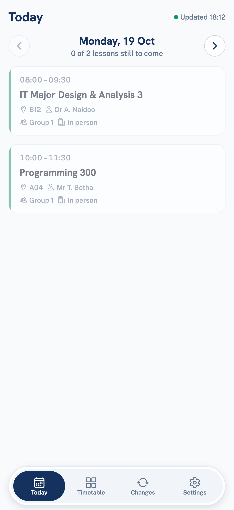
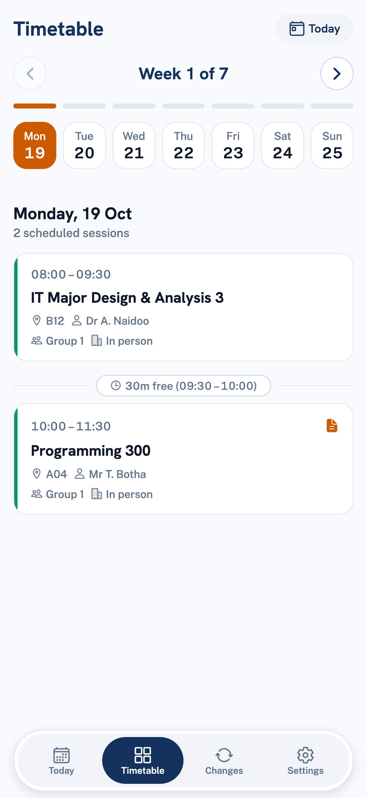
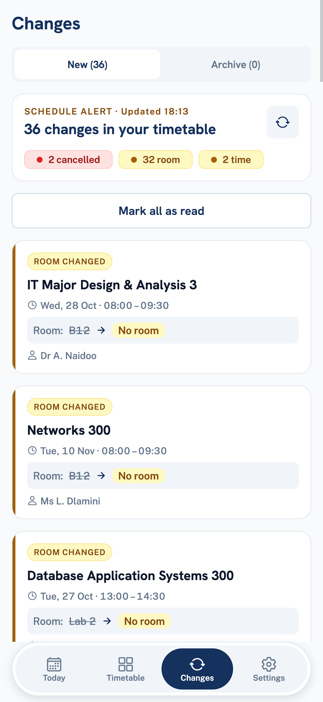
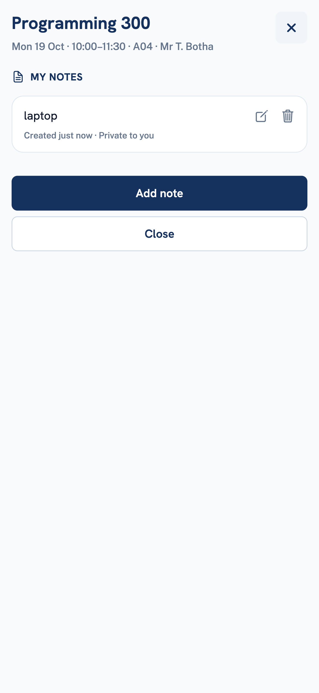
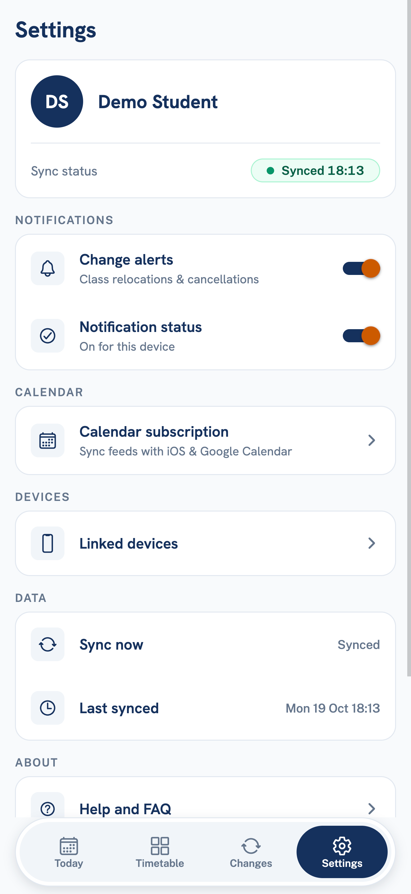
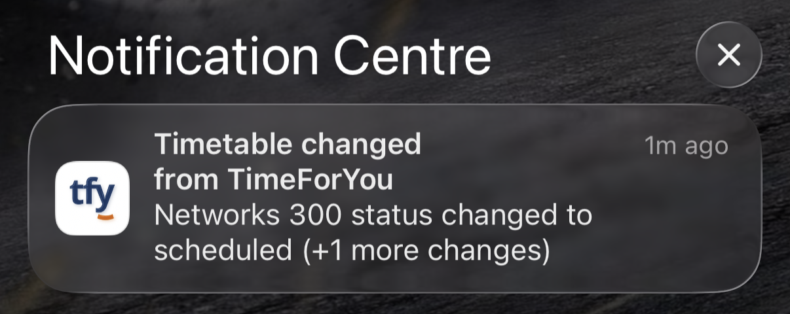
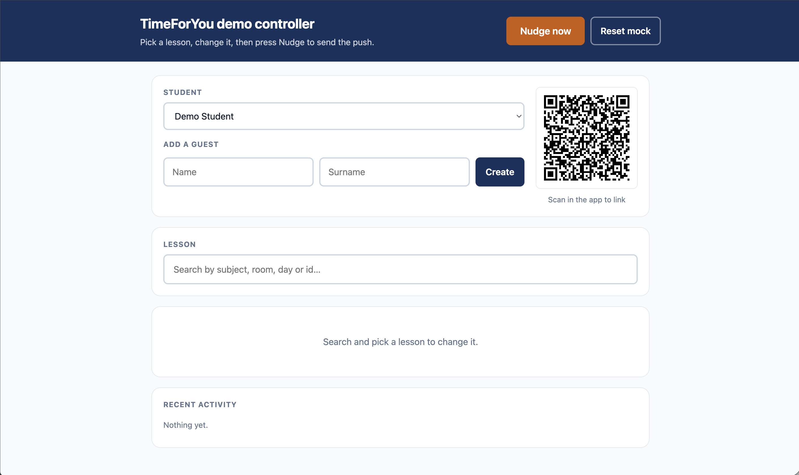

# TimeForYou

> _WebUntis tells you what your timetable is. TimeForYou tells you when it changes._

A mobile-first timetable companion for Eduvos students. It mirrors the institution's WebUntis
schedule, detects changes to it, and pushes those changes to the student's phone.

**Module:** ITMDA3-B34 · **Team:** 6 · **Repo:** `nbence-dev/TimeForYou`

**Just cloned this?** Go to [Running it (for a developer)](#running-it-for-a-developer) — six
steps, and step 6 tells you whether your machine is set up correctly before you write anything.

---

## What it does

- **QR onboarding** — scan the WebUntis QR code, no signup form, no password to remember.
- **Today** — opens instantly from a local cache, online or off. "Where am I supposed to be right
  now" costs zero taps.
- **Timetable** — browse the whole served window week by week, offline, with changed lessons marked.
- **Changes** — a list of recent changes with the old and new room or time side by side, and an
  unseen-change badge on the tab.
- **Push notifications** — a server polls every 10 minutes and sends **one grouped notification**
  that _names_ the change: which lesson, cancelled or moved, and where to. Switch them off or back
  on from Settings.
- **Lesson notes** — add a note to any lesson; notes sync across your devices and queue up when you
  are offline.
- **Calendar feed** — subscribe in Apple or Google Calendar with one tap, and the lessons stay
  correct when they move. The link can be reset.
- **Several devices** — scan the same QR on a second device and it is recognised as you. Linked
  devices are listed in Settings and can be unlinked.

Android gets native push; iPhone runs as an installed PWA using Web Push, with a built-in
add-to-home-screen guide. There is no native iOS app and no paid Apple account involved.

## Screenshots

| Today | Timetable | Changes |
| :---: | :---: | :---: |
|  |  |  |

| Lesson and note | Settings |
| :---: | :---: |
|  |  |

**Push notification** — one grouped notification per poll cycle, naming the lead change.



**Demo controller** — the mock's `/demo` page, used to cancel or move a lesson and trigger a push.



---

## Try it

The shared instance is hosted at **https://app.timeforyou.co.za**. On Android, the latest APK is on
the [Releases](https://github.com/nbence-dev/TimeForYou/releases) page. On iPhone, open the link
in Safari and follow the add-to-home-screen guide.

---

## Status

Phase 1 is built and in showcase rehearsal. It is a graded prototype: the backend is a **mock
WebUntis service**, permanently, because the university moved to an internal timetable system with
no reachable API. Custom reminder rules and real-time note push are out of scope.

The build plan lives in **[issue #3](https://github.com/nbence-dev/TimeForYou/issues/3)**. Where
this README and issue #3 disagree, **#3 wins** — it is newer.

---

## Running it (for a lecturer or marker)

There are two ways in. **Option A needs nothing installed.** Option B runs the whole backend on your
own machine and is the one to use if the hosted instance is unavailable.

No Eduvos credentials are needed for either: the mock is the system's only backend.

### Option A — the hosted instance

1. Open **https://app.timeforyou.co.za** (on iPhone use Safari, then follow the add-to-home-screen
   guide). On Android you can instead install the latest APK from
   [Releases](https://github.com/nbence-dev/TimeForYou/releases).
2. Open the team's demo controller, scan its QR code from the app, and a seeded timetable appears.
3. Press **Cancel** next to a lesson, then **Nudge now**. A push notification arrives within seconds.

### Option B — run it yourself

**Prerequisite: Docker Desktop** for the backend. The app itself needs Node 22 (see below).

#### 1. Start the backend

```bash
git clone https://github.com/nbence-dev/TimeForYou.git
cd TimeForYou
cp .env.example .env          # then follow the CHANGEME comments inside
docker compose up
```

That starts four containers: the API, the Worker, PostgreSQL, and the **mock WebUntis service**. The
Cloudflare Tunnel is team-only and stays out of a bare `up`; you never need it. There is no manual
database step: the API applies pending migrations on startup and the worker waits for it.

You do **not** need Firebase credentials. Without them the worker logs each notification instead of
sending it. With the stack running, watch `docker compose logs -f worker` for lines starting
`Push (logged, not sent)`. Real push delivery to a device needs a Firebase service account; see
[`docs/secrets.md`](docs/secrets.md) if you have one.

The API is on `http://localhost:8080` and the mock's demo controller is on
**http://localhost:8000/demo**.

#### 2. Run the app against it

`docker compose up` does not serve the app, so run it locally. From `app/`:

```bash
cd app && npm install
```

Pick one:

| Where | Command | Notes |
| --- | --- | --- |
| **Browser** (DevTools phone mode) | `npx expo start --web` | Opens on `localhost`, which reaches the API directly. Use Chrome DevTools → device toolbar for a phone-sized view. |
| **Android emulator** | `npm run android` | Needs Android Studio and JDK 17, see [`docs/dev-setup.md`](docs/dev-setup.md). Builds and installs the dev client. If the emulator cannot reach the API, run `adb reverse tcp:8080 tcp:8080`. |
| **A real phone** | see the tunnel steps below | A phone cannot reach your `localhost`, and iPhone needs HTTPS. |

Linking works by **scanning a QR code with a camera**, so the app needs camera access. Open the demo
controller (`/demo`), show its QR code on screen, and scan it with the device or emulator camera, or
with a webcam on desktop.

#### 3. A real phone, using free Cloudflare "try" tunnels

No Cloudflare account is needed. Install `cloudflared` (`brew install cloudflared` on macOS), then
give both the API and the web app a public HTTPS address. Run each tunnel in its own terminal:

```bash
cloudflared tunnel --url http://localhost:8080   # API   -> prints https://<words>.trycloudflare.com
```

Put that API address in `app/.env.local` and in the root `.env` (so calendar links use it), then
restart the API:

```bash
# app/.env.local
EXPO_PUBLIC_API_URL=https://<api-words>.trycloudflare.com
# .env
PUBLIC_BASE_URL=https://<api-words>.trycloudflare.com
```

```bash
docker compose up -d api
cd app
npx expo export -p web                           # rebuild after any change to .env.local
npx serve dist -l 3000
cloudflared tunnel --url http://localhost:3000   # web app -> prints a second trycloudflare.com URL
```

Open the second address on the phone (Safari on iPhone), then scan the QR from the demo page. The
addresses change every time a tunnel restarts, and each tunnel dies when its terminal closes. More
detail and the known gotchas are in [`docs/iphone-pwa-testing.md`](docs/iphone-pwa-testing.md).

#### 4. Trigger a change

Open **http://localhost:8000/demo**. Press **Cancel** next to a lesson, then **Nudge now** to poll
immediately. **Change room**, **Move**, **Restore** and **Reset mock** are on the same page. To do
it by hand instead, see [`docs/triggering-a-push.md`](docs/triggering-a-push.md).

Within a few seconds the change appears on the Changes screen. With Firebase credentials it also
arrives as a push notification; without them it is logged by the worker.

These endpoints are deliberately **unauthenticated**. They are never exposed through the tunnel; the
LAN is the security boundary.

---

## Running it (for a developer)

1. Set your machine up: **[`docs/dev-setup.md`](docs/dev-setup.md)** — Node, .NET, Python,
   Docker, and the Android emulator, for macOS and Windows.
2. Read how the team works: **[`CONTRIBUTING.md`](CONTRIBUTING.md)** — branches, commits, PRs,
   and the ownership verticals. It is short and it is the actual agreement.
3. Make your env file:

```bash
cp .env.example .env
```

4. Handle secrets correctly: **[`docs/secrets.md`](docs/secrets.md)**. One page. Read it before
   your first PR.

5. Install each stack's dependencies. Nothing is vendored, so a fresh clone builds nothing until
   you have run all three:

```bash
# app — Node 22, check with `node -v` first; nvm is per-shell
cd app && npm install && cd ..

# server — restores NuGet for all six projects
cd server && dotnet restore && cd ..

# mock — the venv is git-ignored, so everyone makes their own
# requirements-dev.txt pulls in requirements.txt too, so this is the only install you need
cd mock && python3 -m venv .venv && .venv/bin/pip install -r requirements-dev.txt && cd ..

```

6. Confirm the baseline works before you branch. All three must pass on a clean clone:

```bash
cd app    && npx tsc --noEmit    # no output = clean
cd ../server && dotnet build     # 0 warnings, 0 errors — warnings are errors here
cd ../mock   && .venv/bin/python -c "import fastapi"
```

If `dotnet build` fails on a package advisory (`NU1903`), that is
`server/Directory.Build.props` doing its job — bump the package, don't suppress the warning.

---

## The documents

| Document                                   | What it is                                                                                                                           |
| ------------------------------------------ | ------------------------------------------------------------------------------------------------------------------------------------ |
| [`PROJECT-BRIEF.md`](PROJECT-BRIEF.md)     | **Single source of truth.** Requirements, architecture, ERD, screens, decisions. Every deliverable is expanded from a section of it. |
| [`CONTRIBUTING.md`](CONTRIBUTING.md)       | How the six of us work without standing on each other.                                                                               |
| [`docs/dev-setup.md`](docs/dev-setup.md)   | Getting a machine that can run all four stacks.                                                                                      |
| [`docs/secrets.md`](docs/secrets.md)       | Where secrets live and how not to leak them.                                                                                         |
| [`docs/repo-setup.md`](docs/repo-setup.md) | How GitHub is configured, and how to check it when something looks broken.                                                           |
| [`docs/backlog-process.md`](docs/backlog-process.md) | How the backlog is built, one wave at a time. Read before creating any issue.                                  |
| [`docs/openapi.yaml`](docs/openapi.yaml)   | Hand-authored OpenAPI 3.1 contract for every Phase 1 endpoint.                                                                       |

---

## Layout

Source is organised by what the code does, not by who owns it. Ownership is by feature vertical so
each person delivers something demonstrable end-to-end, but nobody is fenced out of a directory —
full table in [`CONTRIBUTING.md`](CONTRIBUTING.md) §1.

```text
app/                      Expo / React Native — Android build + PWA web export
  src/app/                routes only. Every file here is a URL (Expo Router)
  src/features/           onboarding · timetable · changes · notes · reminders · settings
  src/shared/             api · components · hooks · push · storage · theme
  public/                 PWA: manifest.json, icons, service worker
server/                   one C# solution — TimeForYou.slnx
  TimeForYou.Api/         REST endpoints, iCal subscription feed  (+ Dockerfile)
  TimeForYou.Worker/      polling, change detection, notification dispatch  (+ Dockerfile)
  TimeForYou.WebUntis/    HttpClient facade over mock — mock is the only backend
  TimeForYou.Data/        schema and migrations
  TimeForYou.Domain/      shared domain types
  TimeForYou.Tests/       diff-engine tests, fed by the mock's fixtures
  Directory.Build.props   pins net10.0 and warnings-as-errors for all six projects
mock/                     Python / FastAPI — fake WebUntis + admin trigger endpoints
  app/ · fixtures/ · Dockerfile
docs/                     these documents
docker-compose.yml        API · Worker · mock · Postgres · cloudflared
```

`docker compose up` brings up `db`, `api`, `worker`, and `mock`. `cloudflared` sits behind the
`tunnel` compose profile — the marker's `.env` has no real Cloudflare token, so it stays out of a
bare `up`; the team adds it with `docker compose --profile tunnel up` on the machine that has one.

**Two rules hold this together.** `src/app/` is routes and nothing else — Expo Router turns any
default-exporting file in there into a URL. And `features/*` import from `shared/*`, never from
each other; when two features need the same thing, it moves to `shared/`.

---

## Tech

React Native (Expo) · ASP.NET Core · PostgreSQL · Python (FastAPI) · Docker Compose ·
Firebase Cloud Messaging (native push + Web Push)

Built for ITMDA3-B34 at Eduvos.
